I'm a second-year Mechatronics student at Fontys University of Applied Sciences in Eindhoven. I build things that sense, decide and move: robots, control systems and the software that ties them together. Right now I'm pointing that at defence and security software.

## Looking for

**Summer job or internship, summer 2027**, in defence and security software: tracking and sensor fusion, command and control, real-time or embedded C++. Open to Sweden, Norway, Finland, Denmark and the Netherlands.

## Featured: vakt

[**vakt**](https://github.com/gurmaan-singh/vakt) (Swedish for *guard* or *watch*) is a multi-target radar tracker. It takes noisy measurements of several aircraft, keeps one track per target and says where each is heading. C++20, no frameworks.

| Part | How |
|---|---|
| **Filters** | IMM (constant velocity + coordinated turn) over extended Kalman filters |
| **Association** | Hungarian global nearest neighbour, M-of-N track confirmation |
| **Evaluation** | seeded Monte Carlo runs, GOSPA, RMS error, identity switches |
| **Interfaces** | ASTERIX CAT048 in and out, JSON track picture over UDP |
| **Concurrency** | rx, tracker and tx threads joined by lock-free SPSC queues |
| **Quality** | 34 unit tests, zero warnings at MSVC /W4 |

## Path so far

## Projects

- **Underwater drone** (Fontys Expo project, 2026 to now): designing and building a low-cost underwater drone from scratch for a defence-sector client, in a six-person team of mechatronics, electronics and mechanical students, on a EUR 2,400 budget. On my side I'm studying the autopilot in simulation, comparing a PID controller with an optimised one.
- **Autonomous pick-and-place robot** (client project, 2025 to 2026): a line-following vehicle and a robotic arm that find and move an object on a segmented field within time and budget limits. I was the team's document manager and a CAD contributor: SolidWorks models, 2D drawings and a 36-page technical log with requirement traceability.
- **PLC and HMI control of a mixer tank** (Fontys, 2026): PLC logic and an operator screen in Siemens TIA Portal for an industrial mixing process.
- **NIGHTFALL Remote** (personal, not public): a private phone-to-laptop control app that only works over my own Tailscale network, with TLS, PIN lockout and a local offline voice assistant.

## Skills

- **Software:** C++20, Python, Arduino C++, MATLAB and Simulink, LabVIEW, CMake, GoogleTest, Git
- **Methods:** Kalman filtering, multi-target tracking, data association, Monte Carlo evaluation, control theory (PID and optimised), PLC programming
- **Engineering tools:** SolidWorks (Certified SolidWorks Associate, CSWA), KiCad, 3D printing, CATIA (certification in progress)
- **Languages:** English (fluent), Swedish

## Education and more

- **BSc Mechatronics**, Fontys University of Applied Sciences, 2025 to present: mechanics, electronics, digital systems, control systems and sensors, MATLAB/Simulink, LabVIEW, Siemens TIA Portal.
- **Peer academic mentor and house captain**, IVY School, 2023 to 2025: tutored physics and mathematics, tracked student progress and ran communication between students and staff.
- **Flood relief logistics volunteer**, Punjab, summer 2025: coordinated truck deliveries of goods and relief supplies and confirmed they reached the affected regions.

## Next

A web map of the live track picture (MapLibre, military symbols) fed by vakt, with ADS-B as a real data source.
