

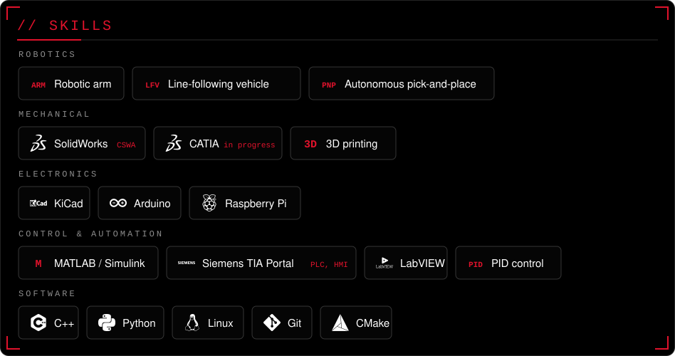

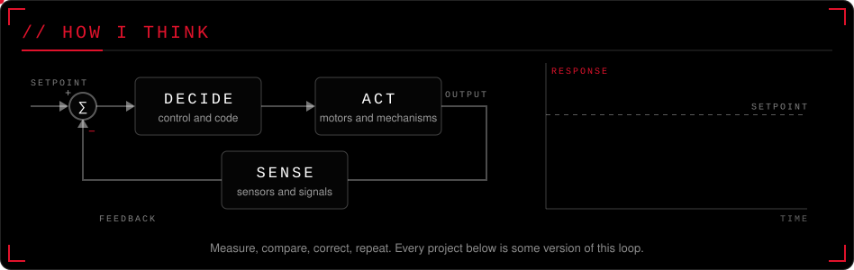


<a href="https://github.com/gurmaan-singh/pidlab" title="PID controller with two plants, the classic tuning rules and a relay autotuner.">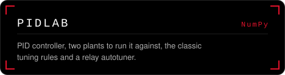</a> <a href="https://github.com/gurmaan-singh/trajopt" title="iLQR trajectory optimisation from scratch, with a receding-horizon MPC controller on top.">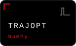</a> <a href="https://github.com/gurmaan-singh/imufuse" title="Attitude from gyro, accelerometer and magnetometer: complementary, Mahony and EKF, compared on the same data.">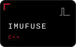</a> <a href="https://github.com/gurmaan-singh/hover" title="Quadrotor flight-controller simulator: rigid body, noisy sensors, 15-state error-state Kalman filter, cascaded PID.">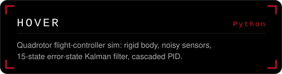</a>

More on these

- **[pidlab](https://github.com/gurmaan-singh/pidlab)** (NumPy): PID in plain NumPy: anti-windup, derivative filtering, Ziegler-Nichols and Cohen-Coon rules, a relay autotuner, tested against a thermal and a motor plant.
- **[trajopt](https://github.com/gurmaan-singh/trajopt)** (NumPy): Iterative LQR with line search and regularisation, then MPC that re-plans every step. Cart-pole and car examples, plots of cost per iteration.
- **[imufuse](https://github.com/gurmaan-singh/imufuse)** (C++): Three attitude estimators on one recorded dataset, with the same bias model and the same plots, so the differences are the filters and nothing else.
- **[hover](https://github.com/gurmaan-singh/hover)** (Python): Full loop from physics to control: rigid-body dynamics, sensor noise and bias, error-state EKF for pose, cascaded PID, waypoint missions and plots.

 <a href="https://github.com/gurmaan-singh/labyrint" title="Grid pathfinding with a browser visualiser: A*, Dijkstra, Jump Point Search, Theta*, D* Lite, bidirectional.">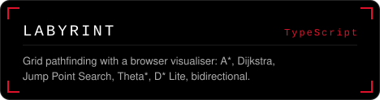</a> 

More on these

- **[kartlagg](https://github.com/gurmaan-singh/kartlagg)** (Python): Monte Carlo localisation on a known map, then occupancy-grid mapping from the same lidar, with animated GIFs of both.
- **[labyrint](https://github.com/gurmaan-singh/labyrint)** (TypeScript): One library, seven planners, a benchmark and a visualiser that shows the expanded nodes. Also the live hero on my portfolio page.
- **[camlab](https://github.com/gurmaan-singh/camlab)** (Python): Pinhole model, Zhang calibration, PnP pose, essential matrix and triangulation, written from scratch and checked against synthetic scenes.

<a href="https://github.com/gurmaan-singh/motionkit" title="Building blocks for motor-control firmware: no heap, no OS, nothing platform specific.">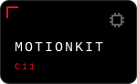</a> <a href="https://github.com/gurmaan-singh/cansim" title="The CAN bus from the bits up: arbitration, bit stuffing, CRC, error handling, a multi-node simulator.">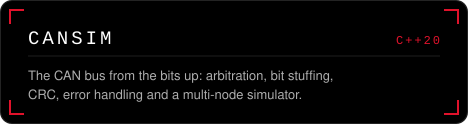</a> <a href="https://github.com/gurmaan-singh/rudp" title="Reliable ordered byte stream on UDP: handshake, sliding window, selective ACKs, retransmission timer, congestion control.">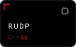</a> <a href="https://github.com/gurmaan-singh/rtsched" title="Real-time scheduling: a tick-by-tick simulator and the rate-monotonic / EDF analysis that predicts it.">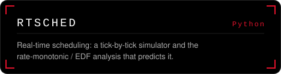</a>

More on these

- **[motionkit](https://github.com/gurmaan-singh/motionkit)** (C11): Fixed-point PID, trapezoidal and S-curve motion profiles, quadrature decoding and filters, every module driven by the caller's tick. Tests run on the host.
- **[cansim](https://github.com/gurmaan-singh/cansim)** (C++20): Bit-level CAN: arbitration between nodes, stuffing, CRC-15, error counters and bus-off, plus a simulator that shows who wins the bus and why.
- **[rudp](https://github.com/gurmaan-singh/rudp)** (C++20): A small TCP-like protocol on UDP with a loss and latency simulator, so the retransmission and congestion logic can be tested deterministically.
- **[rtsched](https://github.com/gurmaan-singh/rtsched)** (Python): Periodic tasks on one processor, fixed-priority and EDF, response-time analysis compared with what the simulator actually does.

<a href="https://github.com/gurmaan-singh/plcsim" title="Interpreter for IEC 61131-3 Structured Text with a proper scan cycle, standard timers and counters.">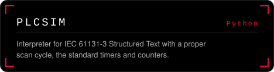</a> <a href="https://github.com/gurmaan-singh/vakt" title="Multi-target tracker for noisy position data: IMM/EKF filters, GNN assignment, track management, GOSPA scoring.">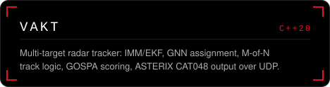</a> <a href="https://github.com/gurmaan-singh/lagesbild" title="Live map of air and sea traffic: standard symbology, tracks, trails and zone alerts, fed by vakt, ADS-B and AIS.">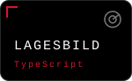</a>

More on these

- **[plcsim](https://github.com/gurmaan-singh/plcsim)** (Python): Parses and runs Structured Text the way a PLC would: scan cycle, TON/TOF/CTU and friends, a static checker and example programs.
- **[vakt](https://github.com/gurmaan-singh/vakt)** (C++20): Tracks several moving objects from noisy measurements: IMM with constant-velocity and turn models, Hungarian assignment, M-of-N confirmation, GOSPA metric, ASTERIX CAT048 output over UDP.
- **[lagesbild](https://github.com/gurmaan-singh/lagesbild)** (TypeScript): A browser map with a track list and zone alerts. Data from a scripted scenario, from vakt over UDP, from live ADS-B aircraft and AIS ships.

